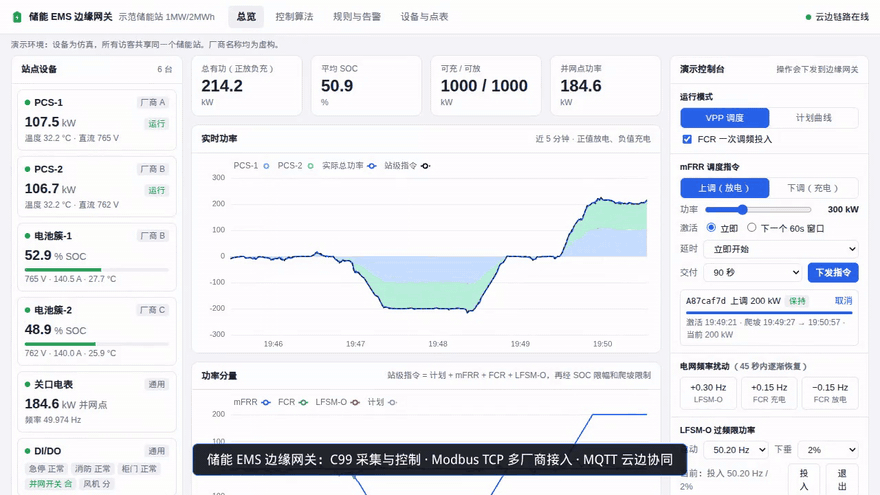

# 储能 EMS 边缘网关演示

部署在储能站现场的 EMS 边缘网关：多厂商设备 Modbus 接入、功率控制、本地存储、云边协同。
设备为仿真，厂商名称均为虚构。详细设计见 [docs/DESIGN.md](docs/DESIGN.md)。

在线演示：<https://ems.edgebot.vip/>



**亮点**

- **100 ms 控制周期**：计划 + mFRR + FCR + LFSM-O 叠加成站级指令，再经 SOC 限幅和爬坡限制；约 4000 行 C99
- **多厂商接入**：3 家虚构厂商的 PCS / BMS 加电表、DI/DO 共 6 台设备，点表用 JSON 配置，支持 4 种字节序；快组 200 ms、慢组 5 s 采集
- **规则引擎**：TinyExpr 表达式，每 200 ms 一轮约 5 µs；1000 条规则时二分查找 33 ns，线性查找 223 ns（网关启动时实测）
- **断网不丢数据**：SQLite WAL 发件箱，每 1 s 或满 200 条打包上云，恢复后按时间顺序补传；云端下发指令往返约 50 ms（本机实测）
- **144 项单元测试**（控制算法 91、点位编解码 23、规则 30），可在 ASan / UBSan 下运行

```
device-sim (Python)  ──Modbus TCP──▶  ems-core (C99)  ──SQLite 发件箱──▶  ems-sync (C99)
                                         采集/控制/存储                      MQTT 上云
                                                                              │
                     浏览器  ◀──WebSocket──  cloud (FastAPI + Vue 页面)  ◀──mosquitto
```

## 进度

| 阶段 | 内容 | 状态 |
|---|---|---|
| 1 | 设备仿真、采集/实时库/存储、上云进程、云端、总览页和点表页 | ✅ 完成 |
| 2 | FCR / mFRR / LFSM-O 控制器、指令下发链路、演示控制台、控制算法页、单元测试 | ✅ 完成 |
| 3 | 规则引擎（TinyExpr）、mFRR 准备期/台阶/激活时间校验、LFSM-O 改造、部分寄存器故障、四种字节序 | ✅ 完成 |
| 4 | 104 接入 ai-scada、固件签名、aarch64 交叉编译 CI；之后 61850 | |

## 用 Docker 运行

```bash
docker compose up -d --build          # 页面：http://127.0.0.1:8095
```

国内网络可在 `.env` 里设置 `REGISTRY=docker.1ms.run`、`PIP_INDEX_URL`、`NPM_REGISTRY`。

## 本地开发

依赖：`gcc make libmodbus-dev libmosquitto-dev libsqlite3-dev mosquitto`，Python 3.12，Node 22。

```bash
python3 -m venv .venv && .venv/bin/pip install pymodbus==3.7.4 fastapi "uvicorn[standard]" paho-mqtt
mosquitto -d                                                  # 本地 broker :1883

cd device-sim && MQTT_HOST=localhost ../.venv/bin/python -m sim          # 设备仿真 :15021-15026
cd ems-core && make && ./build/ems-core -c config                         # 边缘主进程
cd ems-core && ./build/ems-sync -c config                                 # 上云进程
cd cloud && ../.venv/bin/uvicorn app:app --port 8095                      # 云端
cd web && npm install && npm run dev                                      # 前端热更新 :5173
```

单元测试：`make test`（144 项断言：控制算法、点表编解码、规则引擎）；`make test-asan` 在 ASan/UBSan 下运行。

内存检查：`make asan` 后运行 `build-asan/` 下的程序。本机内核 `vm.mmap_rnd_bits=32` 时 ASan 偶发死循环，
用 `setarch -R ./build-asan/ems-core -c config` 运行即可。

故障注入（页面上的演示控制台也可以操作）：

```bash
mosquitto_pub -t sim/scenario -m '{"action":"comm","device":"bat2","down":true}'   # 电池簇-2 通信中断
mosquitto_pub -t sim/scenario -m '{"action":"freq_step","delta_hz":0.3}'          # 频率阶跃 +0.3Hz
mosquitto_pub -t sim/scenario -m '{"action":"di","name":"estop","value":true}'    # 急停
mosquitto_pub -t sim/scenario -m '{"action":"di","name":"door","value":true}'     # 舱门打开（规则 R2 停机）
mosquitto_pub -t sim/scenario -m '{"action":"block","device":"bat1","bad":true}'  # 电池簇-1 单体电压区返回异常响应
```

## 目录

```
docs/DESIGN.md          详细设计
device-sim/sim/         plant.py 物理模型；devices.py 三家虚构厂商的寄存器布局
ems-core/
  config/               site.json 站点设备；vendors/*.json 各厂商点表
  src/config            点表解析、寄存器编解码（字序、倍率、位、枚举）
  src/acq               每设备一个采集线程，批量读合并、离线判定、写队列
  src/rtdb              实时库（读写锁 + 快照）
  src/control           algo.c：FCR / LFSM-O / mFRR 纯函数算法；control.c：叠加、联锁、SOC 限幅、爬坡、PCS 分配、下发间隔
  src/rules             rule_core.c：触发索引（排序 + 二分）、告警抑制、变化检测；rules.c：规则线程、SQLite 持久化、联动动作
  src/cmd               本地指令通道（Unix 数据报套接字，ems-sync → ems-core）
  src/storage           SQLite WAL：遥测、事件、上云发件箱
  src/alarm             异步事件队列
  src/sync              ems-sync 上云进程；下行指令校验过期、去重后转发，回 cmd_ack
  tests/                单元测试：test_algo（控制算法）、test_codec（点表编解码）、test_rules（规则引擎）
  third_party/          cJSON、TinyExpr（均为宽松许可，源码随仓库）
cloud/app.py            云端：MQTT 订阅、历史缓存、WebSocket、指令下发与时延统计、限流、无人时自动演示
web/                    Vue 3 + ECharts 演示页
```

## 主要业务功能

| 功能 | 演示中怎么看 |
|---|---|
| mFRR 激活：准备期 → 台阶爬坡 → 保持 → 降坡 | 控制台下发指令，「控制算法」页曲线上按阶段着色；准备期内功率为 0 |
| mFRR 激活时间校验 | 计划激活迟到但在准备期内照常执行；直接激活可带 0~60 秒提前量，越限被网关拒绝并返回原因 |
| mFRR 同向叠加与平滑交接 | 交付中再下发同向指令，总功率逐条相加、无跳变 |
| LFSM-O 过频限功率 | 以当前出力为参考按下垂削减放电，充电时不调整；控制台可远程投退、改启动频率和下垂系数 |
| PCS 下发间隔 | 同一台 PCS 两次写设定值至少间隔 300ms，期间变化合并 |
| 规则引擎 | 「规则与告警」页在线增删改；TinyExpr 条件；点位变化时二分查找命中规则；首次值不误触发；1 分钟 / 24 小时告警次数上限；动作：告警、写 DO、停止功率输出；告警单独走 alarm 主题 |
| 采集容错 | 某个寄存器块返回异常响应时只影响这一块的点，设备不判离线；链路错误才断开重连 |
| 点表字节序 | 32 位整数支持 ABCD/CDAB/BADC/DCBA，配置写错直接报错（不静默当成大端） |
| 下行指令校验 | ems-sync 按指令类型检查必填字段，过期、重复、格式错误的指令带原因回 cmd_ack |
| 数据库原地升级 | 规则表新增列时先查 `pragma_table_info`，老库启动时自动补列 |

## 与设计稿的差异

- 日志暂用自写的轻量实现（`src/util/log.c`），接口与 zlog 用法相近，现场版本可替换。
- MQTT 默认明文、匿名，只在 compose 内部网络可达；ems-sync 设置 `MQTT_CAFILE`（可选 `MQTT_CERT`/`MQTT_KEY`）时启用 TLS。
- 演示只做主要业务功能：104 / 61850 接入、固件签名、断网补传演示等未实现。
